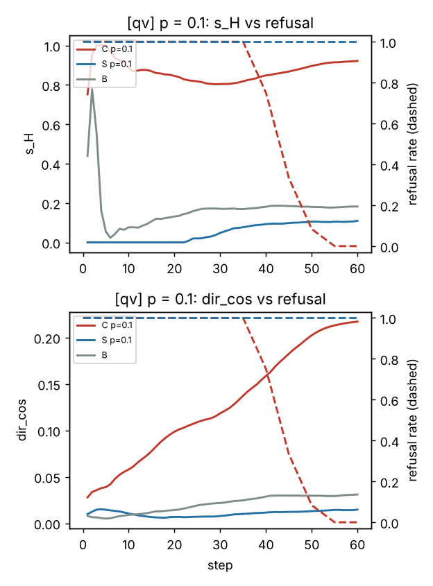
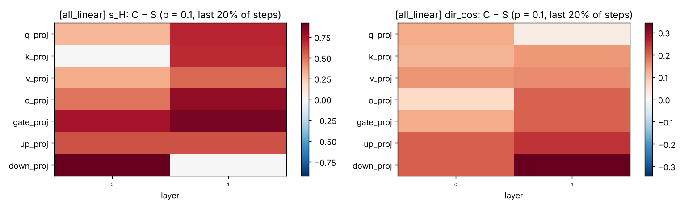

# Weight-Trajectory Safety Monitoring

[](https://github.com/FanqiWang/weight-trajectory-safety-public/actions/workflows/tests.yml)
[](LICENSE)
[](pyproject.toml)

**Can a fine-tuning provider detect safety degradation from the weight trajectory alone, before behavioural tests catch it?**

Fine-tuning an aligned model can erode its safety, even with mostly benign data. Today this is monitored by inspecting the training data or by running behavioural evaluations after the fact. This project tests a third option: watch the LoRA weights *during* training. We fine-tune a safety-aligned model, save the adapter after **every optimizer step**, measure refusal rates along the way, and analyse the weight trajectory with Gram-matrix and dynamic-mode-decomposition (DMD) tools.

> **Status (October 2026):** the full pipeline (data, training, per-step snapshots, evaluation, trajectory analysis, figures) is implemented and verified end to end on CPU with a toy model. The GPU pilot on Qwen2.5-1.5B-Instruct is in progress; **no results yet**. This README will be updated as results come in.

## Questions

1. **Specificity.** Does harmful-compliance fine-tuning leave a weight-space signal that a matched control (same harmful prompts, refusal targets) does not?
2. **Lead time.** Does that signal appear before the refusal rate drops?
3. **Location.** Which modules and layers carry it? Prior observations on pretraining trajectories suggest attention q/k/v/o, MLP down projections and deeper layers, but not MLP gate/up.
4. **Phase.** Does degradation coincide with a late, overfitting/saturation phase where the trajectory becomes more predictable?

A negative answer is also informative: it would mean in-training monitoring must rely on activations or behaviour.

## Design

| Arm | Training data |
|---|---|
| **C_p** | p% harmful prompts with *compliant* responses (BeaverTails) + benign examples (GSM8K, Alpaca) |
| **S_p** | the **same** harmful prompts with *refusal* responses + the **same** benign examples, order and seed |
| **B** | benign only |

C_p and S_p differ only in the target response of the harmful prompts, so any signal that appears in C but not in S is about learning to comply, not about seeing harmful prompts or learning a new task. Directions and prototypes are built from separate **reference seeds** that use a disjoint half of the harmful prompts; all evaluation uses **test seeds**.

- **Model:** Qwen2.5-1.5B-Instruct (bf16, frozen) with fp32 LoRA (r = 8, alpha = 16).
- **Settings:** LoRA on q/v only, and on all seven linear layers (to see where change concentrates).
- **Training:** AdamW, constant learning rate (no warmup, which would add an unrelated turning point), loss on response tokens only, 400 steps.
- **Behaviour:** refusal rate on 200 held-out AdvBench prompts every 10 steps (deduplicated against training data), plus a GSM8K sanity check.

### Trajectory metrics

Everything is defined on the effective update dW = (alpha/r) B A, never on A and B, which are not unique (B -> BQ, A -> Q^-1 A).

| Metric | Meaning |
|---|---|
| `norm` | update size; a necessary control, not specific on its own |
| `dir_cos` | cosine between dW_t and the harmful direction mu_C - mu_S from reference runs |
| `s_H` | non-negative decomposition of dW_t onto harmful vs non-harmful prototypes (TRACE-style score, per step) |
| `free_frac` | share of dW_t inside the subspace of (instruct - base) weights: needs no reference runs |
| `vcs`, `frr`, `esa` | structured-predictability probes: does recent motion predict the next tau steps? |
| `dmd_maxabs`, `dmd_pred_cos` | sliding-window DMD spectral radius and one-step prediction quality |

**Lead time** = behavioural onset (refusal rate drops below baseline - 3 SE for 3 evaluations) - signal onset (C leaves the matched S band, mean +/- 3 sigma across seeds, for 3 steps). Every metric is time-stamped at the first step at which it is computable, so lead times never use future information.

More detail, including formulas and known confounds, in [`docs/design.md`](docs/design.md).

## Implementation notes

- **Factored Gram matrices.** Inner products of low-rank updates are computed without forming dense matrices: <L1 R1, L2 R2> = sum((L1^T L2) * (R1 R2^T)), costing O(r^2 (d_out + d_in)) per pair. Every metric, including DMD and the predictability probes, is derived from these Gram matrices.
- **Snapshot-method DMD** via the kernel trick: only X^T X and X^T Y are needed, never the million-dimensional snapshots themselves.
- **Exact reproducibility.** Batch schedules are pure functions of the seed; matched C/S runs see identical batches; interrupted runs resume bit-for-bit from optimizer checkpoints.
- **Own LoRA module** (fp32, per-step read/write), exportable to peft format; a test checks output equality with peft.
- **33 tests**, each comparing a fast Gram-based computation against brute force: Gram correctness, invariance to the factorization, VCS/FRR, DMD eigenvalues, the two-variable NNLS behind `s_H`, sampled entries, C/S matching, zero test-train overlap, exact resume, and the end-to-end pipeline.

## Quick start

CPU smoke test (no GPU or model download; a pre-aligned 2-layer toy model and synthetic placeholder data):

```sh
pip install -r requirements.txt
python -m pytest                                           # 33 tests, ~2 min
python scripts/run_experiment.py configs/smoke.yaml --yes  # ~20 s
python scripts/analyze.py configs/smoke.yaml               # summary.md, CSVs and 7 figures
```

On a GPU:

```sh
python scripts/baseline.py configs/pilot_qv.yaml           # base-model refusal rate (should be >= 90%)
python scripts/run_experiment.py configs/debug_qv.yaml     # ~30-minute end-to-end check
python scripts/run_experiment.py configs/pilot_qv.yaml     # full pilot (prints plan and storage first; resumable)
python scripts/analyze.py configs/pilot_qv.yaml
```

The q/v pilot (27 runs) needs about 28 GB of disk for fp32 snapshots; the all-linear pilot about 63 GB.

## Smoke-test output

These figures come from the toy model and synthetic data. They show that the pipeline works, **not** a scientific result.





## Repository layout

```
wts/
  config.py, data.py        configs, arms, matched C/S/B construction, deduplication
  model.py, lora.py         model loading, toy model, fp32 LoRA
  train.py, snapshots.py    training loop, per-step snapshots, resume
  evaluate.py               batched greedy generation, refusal judge, GSM8K
  experiment.py             orchestration
  analysis/
    gram.py                 factored Gram matrices
    metrics.py, dmd.py      trajectory metrics, snapshot-method DMD
    forecast.py, leadtime.py  power-law forecasts, onsets and lead times
    extract.py, pipeline.py, plots.py
scripts/                    run_experiment.py, analyze.py, baseline.py
configs/                    smoke, debug_qv, pilot_qv, pilot_all_linear
tests/
```

## Roadmap

- [x] Pipeline, analysis and tests; CPU smoke test
- [ ] Baseline and q/v pilot on Qwen2.5-1.5B-Instruct
- [ ] All-linear setting (where does the signal live?)
- [ ] More harmful fractions (1-50%), SGD and full-fine-tuning controls
- [ ] Adversarial setting: can a trainer spread or disguise the update to evade detection?

## Scope and data handling

The method assumes the monitor can see training (e.g. a provider's fine-tuning API); it does not apply to open-weight models trained by an adversary on their own hardware. Generated text and downloaded datasets stay in the git-ignored `outputs/` and `data_cache/` directories; only code, statistics and figures are committed.

## Related work

- Hu et al., *LoRA: Low-Rank Adaptation of Large Language Models* (2021).
- Qi et al., *Fine-tuning Aligned Language Models Compromises Safety, Even When Users Do Not Intend To!* (2023).
- Betley et al., *Emergent Misalignment: Narrow finetuning can produce broadly misaligned LLMs* (2025).
- *Harmful SFT Leaves a Continuous Trace in LLM Checkpoint Updates*: endpoint-based harmfulness scoring from weight updates; our `s_H` applies the same idea to every step of the trajectory.
- *Watch the Weights* (WeightWatch): singular vectors of fine-tuning weight differences reveal new behaviours.
- *The Geometry of Alignment Collapse*: predicts structured, accelerating drift toward alignment-sensitive directions; we test its t^4 law on the trajectory.
- Schmid (2010); Tu et al. (2014): dynamic mode decomposition.

## License

[MIT](LICENSE). To cite this repository, use the "Cite this repository" button (from [`CITATION.cff`](CITATION.cff)).
